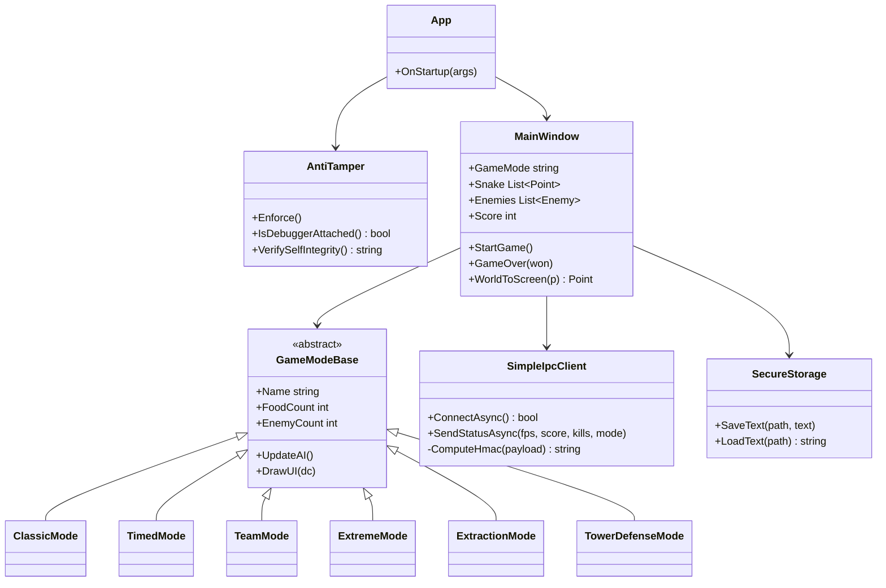

# SnakeGameWpf

<div align="center">

**自由贪吃蛇 · WPF 现代版**

*Six Game Modes · AI Opponents · Custom Renderer · Anti-Tamper · IPC Bridge*

[](https://www.microsoft.com/windows)
[](https://dotnet.microsoft.com/)
[](https://learn.microsoft.com/dotnet/desktop/wpf/)
[](https://github.com/MMA131845/SnakeGameWpf/releases)
[](LICENSE)
[](https://github.com/MMA131845/SnakeGameWpf/stargazers)

[功能特性](#-功能特性) · [快速开始](#-快速开始) · [游戏模式](#-游戏模式) · [架构设计](#-架构设计) · [技术亮点](#-技术亮点) · [配套启动器](#-配套启动器)

</div>

---

## 项目简介

**SnakeGameWpf** 是一款使用 **WPF (.NET 10)** 从零构建的现代贪吃蛇游戏，其前身为 WinForms 版本，在 v8.0.0 完成全面迁移。游戏采用**自绘渲染架构**——所有游戏内画面、UI 面板、对话框均由 `DrawingContext` 直接绘制，不依赖任何 XAML 控件模板，从而实现极高自由度的视觉表现与帧率控制。

游戏通过 **Named Pipe** 与配套启动器 SnakeLauncherWPF 建立实时通信，将 FPS、得分、击杀、模式等状态推送给启动器；同时内建 **HMAC-SHA256 消息签名**、**反调试检测**、**AES-256 配置加密**、**Obfuscar 混淆** 等完整的发布级安全链路。

> **设计哲学**：一个现代游戏，应当拥有原生的性能、自绘的画布、可组合的模式，以及面向多端生态的通信能力。

### 项目定位

| 维度 | 描述 |
|:----:|:-----|
| **目标玩家** | 贪吃蛇爱好者、多模式挑战者、局域网联机玩家 |
| **核心价值** | 六种游戏模式、AI 智能对手、局域网联机、可扩展的塔防 |
| **技术标签** | WPF · .NET 10 · 自绘渲染 · IPC · 反篡改 · 局域网 |
| **代码规模** | ~12000 行 C# / XAML，单可执行项目 |

---

## 功能特性

### 游戏管理

<table>
<tr>
<td width="50%">

**六种游戏模式**
- 经典模式（Classic）：达到 3000 分胜利
- 淘汰之王（Timed）：49 名 AI 决斗竞技
- 占领模式（Team 4v4）：与蓝队合作占据中央区域
- 极限模式（Extreme）：20 敌人，存活 3 分钟
- 搜打撤（Extraction）：搜索容器，撤离成功
- 塔防（Tower Defense）：明日方舟风格守卫战

</td>
<td width="50%">

**智能 AI 对手**
- 追击 / 躲避自适应决策
- AI 主动吃食物，行为接近真人
- 补偿局：连死 5 次后 AI 变蠢
- 惩罚局：连胜 10 局后 AI 开挂
- AI 之间也会发生碰撞与淘汰

</td>
</tr>
</table>

### 战斗系统

| 系统 | 描述 |
|:-----|:-----|
| **连击** | 3 秒内连续吃食物，分数递增，最高 ×10 |
| **道具** | 加速 / 护盾 / 宝石 / 磁铁 四种随机补给 |
| **护盾** | 抵挡一次撞击，给玩家容错空间 |
| **磁铁** | 280px 范围内食物被吸引到蛇头 |
| **加速** | 1.5 倍速持续 8 秒，可与 Ctrl 加速叠加 |
| **宝石** | 立即 +50 分，击杀掉落更丰厚 |

### 数据与统计

- **成就系统**：初次击杀 / 十人斩 / 五十人斩 / 常胜将军 / 生存专家 / 占领专家
- **历史排行榜**：淘汰之王模式的最高分记录（AES 加密存储）
- **实时排行**：游戏内显示前 5 名（玩家 + AI）
- **击杀掉落**：击杀 AI 掉落与其长度相等的食物，吃完获得 AI 全部分数

### IPC 通信与反作弊

- **Named Pipe 上报**：FPS / 得分 / 击杀 / 模式 / 时间戳，每 200ms 一次
- **HMAC-SHA256 签名**：与启动器共享 32 字节密钥
- **时间戳防重放**：30 秒容忍窗口
- **反调试检测**：检测 dnSpy / x64dbg / Cheat Engine 等 15 种工具
- **自完整性校验**：编译期嵌入哈希，运行时校验 EXE
- **AES-256 加密**：所有配置与统计数据加密封装

### 局域网联机

- **TCP 长连接**：JSON 消息协议
- **主机模式**：创建房间并广播状态
- **客户端模式**：输入方向与加速状态
- **状态同步**：33ms 一次全量广播

---

## 游戏模式

### 经典模式（Classic）

最传统的贪吃蛇玩法，AI 与玩家共享地图。

- **胜利条件**：达到 3000 分
- **食物数量**：125 个
- **AI 数量**：10 个
- **核心机制**：连击 + 道具 + 击杀掉落

### 淘汰之王（Timed）

99 名 AI 竞技场，接近《地平线》系列的决斗玩法。

- **AI 数量**：49 个（+ 玩家 = 50 名）
- **决斗机制**：靠近 600px 内 AI 按 `F` 发起决斗，双方冲向同一目标点，先到者胜
- **等级系统**：击败对手等级 +1，速度随等级提升（最高 10 级）
- **毒圈收缩**：每 5 分钟收缩一次，共 3 次；圈外停留 15 秒判负
- **实时排行**：右侧显示前 5 名
- **奖励**：胜利者淘汰对手，+1 等级，速度提升

**决斗 AI 行为**：
- 高等级 AI 更倾向躲避（躲避概率 = 0.75 + 等级 × 0.02，上限 0.95）
- 圈外时优先向圈内移动
- 附近食物会顺路吃

### 占领模式（Team 4v4）

与蓝队 AI 合作，对抗红队。

- **目标**：占领地图中央区域，进度条先到 +30 或 -30
- **队伍**：蓝队（3 AI + 玩家）vs 红队（4 AI）
- **占点逻辑**：圈内每队人数差决定进度条推进速度
- **屏幕外提示**：黄色箭头指向占领区，附带距离数值

### 极限模式（Extreme）

高难度挑战，考验存活能力。

- **胜利条件**：存活 3 分钟
- **食物数量**：60 个（比经典模式少一半）
- **AI 数量**：20 个
- **加速时长**：2.5 秒（经典模式 5 秒）
- **分数倍率**：每秒提升 0.5%，上限 2.0×
- **食物雨**：每 30 秒触发一次，一次生成 25 个食物

### 搜打撤（Extraction）

PvPvE 撤离玩法。

- **地图**：废弃工厂 / 边境森林 / 航天基地（三选一）
- **搜索机制**：靠近容器按 `F` 搜索，搜索完成再按 `F` 拾取
- **撤离条件**：站在绿色撤离点 9 秒
- **分数**：搜索容器随机获得 20~100 分
- **危险**：航天基地有红色燃烧弹持续 10 秒
- **奖励**：撤离成功解锁全局 Q 技能

**三张地图对比**：

| 地图 | 尺寸 | 容器 | 敌人 | 敌人速度 | 敌人生命 | 燃烧弹 |
|:-----|:----:|:----:|:----:|:--------:|:--------:|:------:|
| 废弃工厂 | 4000×3500 | 30 | 5 | 1.0× | 1 | 无 |
| 边境森林 | 5000×4000 | 99 | 10 | 1.5× | 1 | 无 |
| 航天基地 | 8000×6000 | 999 | 20 | 5.0× | 3 | 有 |

### 塔防（Tower Defense）

明日方舟风格的塔防玩法，10 个关卡。

- **敌人**：从橙色入口沿棕色路径走向绿色终点，到达终点扣 1 生命
- **干员**：三种类型，各有攻击范围与冷却
- **费用**：随时间自动回复，每秒 +1
- **干员售价**：近卫 12 / 狙击 15 / 术师 18
- **移除返还**：返还一半费用
- **加速**：1× / 2× / 4× 三档

**三种干员**：

| 干员 | 费用 | 攻击 | 冷却 | 攻击范围 |
|:-----|:----:|:----:|:----:|:---------|
| 近卫 | 12 | 3 | 0.80s | 单方向 3 格 |
| 狙击 | 15 | 2 | 0.50s | 单方向 5 格 |
| 术师 | 18 | 5 | 1.20s | 周围 8 格 |

**十关难度曲线**：

| 关卡 | 名称 | 难度 | 尺寸 | 波次 | 生命 | 初始费用 |
|:----:|:-----|:----:|:----:|:----:|:----:|:--------:|
| 1 | 训练场 | ★ | 12×8 | 5 | 10 | 25 |
| 2 | 之字路 | ★ | 12×8 | 6 | 10 | 25 |
| 3 | 十字路口 | ★★ | 12×8 | 7 | 10 | 20 |
| 4 | 迷宫入口 | ★★ | 12×8 | 8 | 10 | 20 |
| 5 | 中央要塞 | ★★★ | 12×8 | 8 | 10 | 18 |
| 6 | 大峡谷 | ★★★ | 14×8 | 9 | 10 | 20 |
| 7 | 双塔 | ★★★★ | 12×8 | 9 | 10 | 18 |
| 8 | 螺旋塔 | ★★★★ | 12×8 | 10 | 10 | 16 |
| 9 | 围攻 | ★★★★★ | 14×10 | 10 | 10 | 22 |
| 10 | 终局 | ★★★★★ | 14×10 | 12 | 8 | 20 |

---

## 快速开始

### 环境要求

| 组件 | 最低版本 | 推荐版本 |
|:-----|:--------:|:--------:|
| Windows | 10 (1809) | 11 22H2+ |
| .NET SDK | 10.0 | 10.0.100+ |
| Visual Studio | 2022 (17.12+) | 2022 17.14+ |

### 构建

```powershell
# 1. 克隆仓库
git clone https://github.com/MMA131845/SnakeGameWpf.git
cd SnakeGameWpf

# 2. 还原 NuGet 包
dotnet restore

# 3. 编译 Release
dotnet build -c Release

# 4. 运行
.\bin\Release\net10.0-windows\SnakeGame.exe
```

### 发布（含混淆）

```powershell
# 使用 Obfuscar 混淆后发布
dotnet publish -c Release -r win-x64 --self-contained false
```

启用条件：

1. `tools/obfuscar/Obfuscar.Console.exe` 存在
2. `obfuscar.xml` 存在

### 首次运行

首次运行会：

1. 触发**反调试与完整性校验**（`AntiTamper.Enforce`）
2. 弹出**名字输入界面**（保存到加密文件 `player_name.txt`）
3. 版本号变更时弹出**更新日志**

---

## 操作指南

### 键盘与鼠标

| 操作 | 功能 |
|:-----|:-----|
| **鼠标移动** | 控制蛇头方向 |
| **Ctrl（长按）** | 加速（消耗加速时长） |
| **F** | 决斗（淘汰之王）/ 搜索容器（搜打撤） |
| **Q** | 释放技能（解锁后可用） |
| **O** | 局域网联机 |
| **H** | 历史排行榜 |
| **J** | 成就 |
| **L** | 更新日志 |
| **S** | 设置 |
| **Esc** | 暂停 / 返回上级 |
| **F12** | 开发者工具 |
| **Space** | 开始游戏 / 切换塔防速度 |

### 开发者工具（F12）

游戏内置 10 个调试按钮，用于测试：

| 按钮 | 功能 |
|:-----|:-----|
| +1000 分 | 立即加 1000 分 |
| +100 分 | 立即加 100 分 |
| 杀死所有 AI | 清空所有敌人 |
| 清空食物 | 清空所有食物 |
| 触发食物雨 | 立即生成 25 个食物 |
| 清空道具 | 清空所有未拾取道具 |
| 无敌开关 | 撞墙不死、不触发碰撞 |
| 立即胜利 | 强制胜利结算 |
| 立即失败 | 强制失败结算 |
| 补偿局开关 | 手动开启/关闭补偿局 |

### 模式选择

主菜单点击「开始游戏」→ 选择模式 → 完成前置选择：

- **淘汰之王** → 选择初始等级（当前固定为 1）
- **搜打撤** → 选择地图
- **塔防** → 选择关卡（未解锁关卡显示锁）

---

## 架构设计

### 模块分层

```
┌─────────────────────────────────────────────────────────────────┐
│                         Presentation Layer                       │
│  ┌────────────────┐  ┌────────────────┐  ┌────────────────┐    │
│  │  MainWindow    │  │ SettingsWindow │  │ TutorialWindow │    │
│  │  (自绘全屏)    │  │ (XAML 控件)    │  │ (XAML 控件)    │    │
│  └────────────────┘  └────────────────┘  └────────────────┘    │
├─────────────────────────────────────────────────────────────────┤
│                        Game Mode Layer                           │
│  ┌────────────┐ ┌────────────┐ ┌────────────┐ ┌─────────────┐  │
│  │ClassicMode │ │  TimedMode │ │  TeamMode  │ │ExtremeMode  │  │
│  └────────────┘ └────────────┘ └────────────┘ └─────────────┘  │
│  ┌────────────┐ ┌────────────────────┐                          │
│  │ExtractMode │ │TowerDefenseMode    │                          │
│  └────────────┘ └────────────────────┘                          │
├─────────────────────────────────────────────────────────────────┤
│                         Domain Layer                             │
│  ┌────────────┐  ┌────────────┐  ┌────────────┐  ┌──────────┐  │
│  │ GameEngine │  │ GameStats  │  │  TDLevels  │  │ AppSet   │  │
│  │            │  │            │  │ TDProgress │  │          │  │
│  └────────────┘  └────────────┘  └────────────┘  └──────────┘  │
├─────────────────────────────────────────────────────────────────┤
│                    Infrastructure Layer                          │
│  ┌──────────────┐  ┌──────────────┐  ┌────────────────────┐    │
│  │SimpleIpcClient│ │ GameServer   │  │  SecureStorage     │    │
│  │  (IPC 上报)  │  │ GameNetClient│  │   (AES-256)        │    │
│  └──────────────┘  └──────────────┘  └────────────────────┘    │
│  ┌──────────────┐  ┌──────────────┐                             │
│  │  AntiTamper  │  │RenderResources│                            │
│  │  (反调试)    │  │  (缓存层)    │                             │
│  └──────────────┘  └──────────────┘                             │
└─────────────────────────────────────────────────────────────────┘
```

### 核心类图（节选）



### 目录结构

```
SnakeGameWpf/
│
├── SnakeGame.csproj                    主工程文件 (.NET 10)
├── obfuscar.xml                        Obfuscar 混淆配置
├── app.manifest                        应用清单（DPI 感知等）
│
├── 核心引擎
│   ├── App.xaml(.cs)                   应用入口 + AntiTamper.Enforce
│   ├── MainWindow.xaml(.cs)            主窗口 + 自绘游戏画面
│   ├── GameEngine.cs                   引擎（用于联机）
│   ├── GameModeBase.cs                 模式基类 + AI 工具方法
│   └── Models.cs                       Enemy / Food / PowerUp / Particle
│
├── 游戏模式
│   ├── ClassicMode.cs                  经典模式 AI
│   ├── TimedMode.cs                    淘汰之王（含道路、决斗、毒圈）
│   ├── TeamMode.cs                     占领模式 AI
│   ├── ExtremeMode.cs                  极限模式 AI
│   ├── ExtractionMode.cs               搜打撤（容器 + 撤离）
│   └── TowerDefenseMode.cs             塔防模式
│
├── 塔防数据
│   ├── TDLevels.cs                     10 关静态数据
│   └── TDProgress.cs                   关卡解锁进度（加密存储）
│
├── 配置与安全
│   ├── AppSettings.cs                  设置数据模型
│   ├── SecureStorage.cs                AES-256 加密封装
│   └── AntiTamper.cs                   反调试 + 完整性校验
│
├── 通信
│   ├── SimpleIpcClient.cs              Named Pipe 上报（HMAC 签名）
│   ├── GameServer.cs                   TCP 服务端（联机主机）
│   └── GameNetworkClient.cs            TCP 客户端（联机加入）
│
├── UI 窗口
│   ├── SettingsWindow.xaml(.cs)        设置窗口
│   ├── RankingsWindow.xaml(.cs)        排行榜窗口
│   ├── AchievementsWindow.xaml(.cs)    成就窗口
│   ├── OnlineLobbyWindow.xaml(.cs)     联机大厅窗口
│   └── TutorialWindow.xaml(.cs)        教程窗口
│
└── 渲染辅助
    └── RenderResources.cs              Brush / Pen / Typeface 缓存
```

---

## 技术亮点

### 1. 全自绘渲染架构

主窗口只包含一个 `RootGrid` 与一个隐藏的 `InputBox`，所有游戏画面、菜单、面板、对话框均通过重写 `OnRender(DrawingContext dc)` 绘制：

```csharp
protected override void OnRender(DrawingContext dc)
{
    base.OnRender(dc);

    // 背景层
    if (useCustomBg)
        DrawBackgroundImageFill(dc, _customBg, _screenWidth, _screenHeight);
    else
        dc.DrawRectangle(RenderResources.Brush(themeBg), null, new Rect(0, 0, _screenWidth, _screenHeight));

    // 状态派发
    if (ShowNameInput) { DrawNameInput(dc); return; }
    if (ShowSettings)  { DrawSettingsInline(dc); return; }
    if (ShowModeSelect){ DrawModeSelect(dc); return; }
    if (!GameStarted)  { DrawStartMenu(dc); return; }

    // 游戏画面
    DrawBackground(dc);
    DrawFoods(dc);
    DrawPowerUps(dc);
    DrawSnake(dc);
    DrawEnemies(dc);
    DrawHUD(dc);
    _currentMode?.DrawUI(dc);
}
```

**收益**：
- 完全自由的视觉效果
- 无 WPF 控件树开销，60 FPS 稳定
- 支持 DPI 自适应与实时缩放

### 2. 严格缓存的渲染资源

```csharp
public static SolidColorBrush Brush(byte a, byte r, byte g, byte b)
{
    uint key = ((uint)a << 24) | ((uint)r << 16) | ((uint)g << 8) | b;
    if (_brushCache.TryGetValue(key, out var cached)) return cached;

    var br = new SolidColorBrush(Color.FromArgb(a, r, g, b));
    br.Freeze();                        // 冻结，允许跨线程使用
    _brushCache[key] = br;
    return br;
}

public static Pen Pen(Color c, double thickness)
{
    // 用 ulong 作为 key，避免 uint 左移溢出
    uint ck = ((uint)c.A << 24) | ((uint)c.R << 16) | ((uint)c.G << 8) | c.B;
    uint tk = (uint)Math.Round(thickness * 100);
    ulong key = ((ulong)ck << 32) | tk;

    if (_penCache.TryGetValue(key, out var p)) return p;
    p = new Pen(Brush(c), thickness);
    p.Freeze();
    _penCache[key] = p;
    return p;
}
```

缓存大小超过 512 时自动清空，防止内存泄漏。

### 3. IPC 上报与 HMAC 签名

游戏每 200ms 通过 Named Pipe 向启动器上报状态：

```csharp
public async Task SendStatusAsync(int fps, int score, int kills, string mode)
{
    if (!_connected || _pipe == null || !_pipe.IsConnected) return;

    long ts = DateTimeOffset.UtcNow.ToUnixTimeSeconds();
    string payload = $"FPS:{fps},SCORE:{score},KILLS:{kills},MODE:{mode},TS:{ts}";
    string sig = ComputeHmac(payload);

    byte[] data = Encoding.UTF8.GetBytes(payload + ",SIG:" + sig + "\n");
    await _pipe.WriteAsync(data, 0, data.Length);
    await _pipe.FlushAsync();
}

private static string ComputeHmac(string payload)
{
    using (var h = new HMACSHA256(RootKey))
    {
        byte[] mac = h.ComputeHash(Encoding.UTF8.GetBytes(payload));
        var sb = new StringBuilder(mac.Length * 2);
        foreach (var b in mac) sb.Append(b.ToString("x2"));
        return sb.ToString();
    }
}
```

`RootKey` 与启动器端完全一致，且时间戳参与签名，防止重放攻击。

### 4. 反调试与完整性校验

```csharp
public static void Enforce()
{
    if (IsDebuggerAttached())
    {
        // 不弹窗，静默退出（避免打草惊蛇）
        Environment.Exit(0);
    }

    var err = VerifySelfIntegrity();
    if (err != null)
    {
        MessageBox.Show("游戏文件已被修改，无法启动。\n\n" + err, "完整性校验失败");
        Environment.Exit(2);
    }
}

public static bool IsDebuggerAttached()
{
    // 1) 托管调试器
    if (Debugger.IsAttached || Debugger.IsLogging()) return true;

    // 2) 原生调试器
    CheckRemoteDebuggerPresent(GetCurrentProcess(), out bool remote);
    if (remote) return true;

    // 3) 常见工具进程名匹配
    foreach (var p in Process.GetProcesses())
    {
        string n = p.ProcessName.ToLowerInvariant();
        foreach (var d in DebuggerNames)   // 15 种调试/反编译工具
            if (n == d || n.StartsWith(d)) return true;
    }
    return false;
}
```

**检测的工具**：dnSpy、ILSpy、x64dbg、x32dbg、ollydbg、IDA、Cheat Engine、Process Hacker、Procmon、Scylla、LordPE 等。

### 5. AES-256 配置加密

所有配置与统计文件（`app_settings_wpf.json`、`td_progress.txt`、`player_name.txt` 等）均采用 AES-256-CBC 加密封装：

```
文件格式：[magic "SG01"(4B)][IV(16B)][ciphertext]
```

- **兼容旧明文文件**：读取时检测 magic，无 magic 按明文解析，下次保存自动加密
- **密钥硬编码**：32 字节密钥存于 `SecureStorage.Key`
- **IV 随机**：每次保存重新生成 IV

### 6. 塔防模式 3D 视角

塔防模式在地图俯视与斜视之间平滑过渡：

```csharp
private double _viewTilt = 0.0;
private const double TiltSpeed = 6.7;   // 0.15 秒内完成

private void UpdateViewTransition(double dt)
{
    double target = ShouldBeTilted() ? 1.0 : 0.0;
    double delta = target - _viewTilt;
    double step = Math.Sign(delta) * Math.Min(Math.Abs(delta), TiltSpeed * dt);
    _viewTilt += step;
}
```

**投影函数**：

```csharp
private Point Project(double x, double y, double z)
{
    double sx = x + z * _shear;         // 水平方向剪切（模仿透视）
    double sy = z * _squash - y * _heightFactor;  // 垂直方向压缩
    return new Point(_originX + sx * _cellScale, _originY + sy * _cellScale);
}
```

干员用**伪立方体**表现——左面深色，正面渐变，顶面菱形，实现 3D 立体感。

### 7. AI 状态机

各模式 AI 共用基类工具，核心决策伪代码：

```
if (玩家在触发半径内) {
    if (敌人长度 > 玩家长度) attack_threshold = 3.4
    else if (敌人长度 < 玩家长度 / 2) attack_threshold = 2.0
    else attack_threshold = 2.8

    phase = (aiTime + enemyHash * 0.001) % 4.0
    if (phase < attack_threshold)
        朝玩家方向前进
    else
        躲避 + 垂直方向侧移
}
else {
    if (附近有食物) 追食物
    else 随机游走
}
```

**补偿局**：把触发半径缩到 120px，永远躲避，不主动攻击。
**惩罚局**：AI 速度 ×3、穿墙、瞬移、玩家分数 ×2。

### 8. 局域网 TCP 联机

服务端：

```csharp
private void UpdateCallback(object state)
{
    var inputs = new Dictionary<string, (Point dir, bool boost)>();
    lock (_sync)
        foreach (var c in _clients)
            if (c.PlayerId != null && c.Ready)
                inputs[c.PlayerId] = (c.Direction, c.Boosting);

    _engine.Update(UpdateInterval / 1000f, inputs);
    var gameState = _engine.GetState();
    var json = JObject.FromObject(new { Type = "state", State = gameState });
    Broadcast(json.ToString());
}
```

客户端：

```csharp
public async Task SendInputAsync(Point dir, bool boosting) => SendJsonAsync(new JObject
{
    ["Type"] = "input",
    ["Direction"] = new JObject { ["X"] = dir.X, ["Y"] = dir.Y },
    ["Boosting"] = boosting
});
```

### 9. 补偿局与惩罚局

**补偿局**（连死 5 次）：
- AI 速度 ×0.55
- 触发半径缩到 120px
- AI 永远躲避，不主动攻击
- 补偿局提示条：💖 补偿局

**惩罚局**（连胜 10 局）：
- AI 速度 ×3
- AI 穿墙（不受边界约束）
- AI 每 3 秒随机瞬移到玩家附近
- 玩家分数 ×2
- 神仙局提示条：⚡ 神仙局 ⚡

### 10. Obfuscar 混淆

Release 构建自动触发 Obfuscar：

```xml
<Target Name="PostBuildObfuscate" AfterTargets="Build"
        Condition="'$(Configuration)'=='Release' AND Exists('..\tools\obfuscar\Obfuscar.Console.exe')">
    <Exec Command="&quot;..\tools\obfuscar\Obfuscar.Console.exe&quot; &quot;obfuscar.xml&quot;" />
</Target>
```

**跳过清单**（WPF 反射依赖）：
- `SnakeGame.App` / `MainWindow` / `SettingsWindow` 等窗口类
- `SnakeGame.AppSettings` / `MapData` / `Achievement`（JSON 反射）
- `Newtonsoft.*`

---

## 技术栈

<table>
<tr>
<td align="center" width="25%">
<br/>
<b>C# Latest</b><br/>
<sub>LangVersion latest</sub>
</td>
<td align="center" width="25%">
<br/>
<b>.NET 10</b><br/>
<sub>net10.0-windows</sub>
</td>
<td align="center" width="25%">
<br/>
<b>WPF</b><br/>
<sub>自绘渲染</sub>
</td>
<td align="center" width="25%">
<br/>
<b>IPC</b><br/>
<sub>Named Pipe</sub>
</td>
</tr>
</table>

**NuGet 依赖**：

| 包名 | 版本 | 用途 |
|:-----|:----:|:-----|
| `Newtonsoft.Json` | 13.0.4 | JSON 序列化（联机、存档） |

---

## 开发路线

### 已完成

- [x] 从 WinForms 全面迁移到 WPF
- [x] 六种游戏模式（经典 / 淘汰 / 占领 / 极限 / 搜打撤 / 塔防）
- [x] 智能 AI 对手（追击 / 躲避 / 吃食物）
- [x] 连击 + 道具 + 粒子 + 飘分系统
- [x] 补偿局 / 惩罚局
- [x] Named Pipe IPC 上报（HMAC 签名）
- [x] 局域网 TCP 联机
- [x] AES-256 配置加密
- [x] 反调试 + 完整性自检
- [x] Obfuscar 混淆发布
- [x] 自定义背景图片（填充模式）
- [x] 主题系统（Windows11 / 深色 / 浅色 / 纯白）
- [x] 窗口几何记忆
- [x] 成就系统
- [x] 排行榜（加密存储）
- [x] 塔防 10 关卡 + 3D 视角过渡

### 规划中

- [ ] **在线对战**：基于 SignalR 或自定义中继的互联网联机
- [ ] **MOD 系统**：支持自定义地图 / 皮肤 / 音效包
- [ ] **视频录制**：内置 Replay 录制与回放

### 想法池

- [ ] 手柄支持

---

## 配套启动器

<table>
<tr>
<td align="center">
<a href="https://github.com/MMA131845/SnakeLauncherWPF">

</a>
<br/><br/>
<b>贪吃蛇启动器</b><br/>
<sub>WPF (.NET Framework 4.8) · Liquid Glass · IPC · 反作弊</sub>
</td>
</tr>
</table>

启动器通过 `SnakeGameFPSPipe` 接收游戏上报，实现：

- **实时状态栏**：FPS / 得分 / 击杀 / 模式 / 时长
- **数据统计页**：累计游玩 / 启动次数 / 最高分
- **反作弊告警**：签名失败 / 时间戳过期 / 增速异常
- **多版本管理**：同时管理 C# 与 Python 版

游戏上报协议：

```
FPS:60,SCORE:1200,KILLS:15,MODE:classic,TS:1735689600,SIG:a3f1b2c8...
```

---

## 常见问题

<details>
<summary><b>Q1: 启动器提示「版本不兼容」怎么办？</b></summary>

启动器只支持特定版本范围的 IPC 通信（C# 版无版本限制，Python 版限于 `2.2.0 ~ 2.4.0` 或 `2.15.4 ~ 3.0.5`）。C# 版游戏（本项目）任意版本均兼容。
</details>

<details>
<summary><b>Q2: 游戏启动就闪退？</b></summary>

可能原因：

1. **反调试工具正在运行** — 关闭 dnSpy / x64dbg / Cheat Engine 等工具后重试
2. **EXE 被修改** — 从官方渠道重新下载
3. **缺少 .NET 10 运行时** — 前往 [dotnet.microsoft.com](https://dotnet.microsoft.com/) 下载

反调试机制会**静默退出**，不弹窗。
</details>

<details>
<summary><b>Q3: 配置文件在哪个目录？</b></summary>

所有配置与统计文件位于**游戏 EXE 同目录**：

| 文件 | 内容 |
|:-----|:-----|
| `app_settings_wpf.json` | 游戏设置（AES 加密） |
| `player_name.txt` | 玩家名字（AES 加密） |
| `achievements.json` | 成就进度（AES 加密） |
| `timed_scores.json` | 淘汰之王排行榜（AES 加密） |
| `td_progress.txt` | 塔防解锁进度（AES 加密） |
| `death_count.txt` | 连死次数（AES 加密） |
| `win_streak.txt` | 连胜次数（AES 加密） |

想清空游戏数据，删除这些文件即可。
</details>

<details>
<summary><b>Q4: 局域网联机怎么用？</b></summary>

1. **主机**：主菜单按 `O` → 选择「创建房间」→ 确定
2. **客户端**：主菜单按 `O` → 选择「加入房间」→ 输入主机 IP 与端口 → 确定
3. 默认端口 8888，防火墙需放行
4. 主机与客户端需在同一局域网内
</details>

<details>
<summary><b>Q5: 塔防怎么玩？</b></summary>

1. 从「开始游戏」→ 选择「塔防」
2. 选择已解锁的关卡
3. **点击干员卡** → **点击地图上的可部署格** → **选择攻击方向**
4. 干员自动开火，击杀敌人获得费用
5. 敌人到达终点扣 1 生命，生命归零则失败
6. 全部波次清剿即胜利

**技巧**：蛇头贴近路径拐角，可以覆盖更多敌人；术师攻击范围覆盖周围 8 格，适合转角处。
</details>

<details>
<summary><b>Q6: 如何用 F12 开发者工具？</b></summary>

游戏内按 `F12` 切换面板显示：

- 面板位于**右下角**
- 10 个按钮覆盖常见调试功能
- 无敌模式启用时会有**金色光环**提示
- 面板外点击不受影响

**注意**：F12 是调试功能，正常游玩建议关闭。
</details>

---

## 贡献指南

我们欢迎任何形式的贡献！

```bash
# 1. Fork 本仓库
# 2. 创建特性分支
git checkout -b feature/new-game-mode

# 3. 提交更改（遵循 Conventional Commits）
git commit -m "feat(mode): add battle royale game mode"

# 4. 推送并创建 Pull Request
git push origin feature/new-game-mode
```

**代码规范**：

- C# 遵循 [Microsoft C# Coding Conventions](https://learn.microsoft.com/dotnet/csharp/fundamentals/coding-style/coding-conventions)
- XAML 命名使用 PascalCase
- 提交信息遵循 [Conventional Commits](https://www.conventionalcommits.org/)

**提交类型**：`feat` · `fix` · `docs` · `style` · `refactor` · `perf` · `test` · `chore`

**添加新游戏模式**：

1. 继承 `GameModeBase`
2. 实现 `Name` / `FoodCount` / `EnemyCount` / `AiDifficulty`
3. 覆写 `UpdateAI()` / `DrawUI()`
4. 在 `MainWindow.StartGame()` 的 `switch` 中注册
5. 在 `DrawModeSelect()` 中加入模式卡片
6. 在 `TutorialWindow.ModeData` 中加入教程文本

---

## 开源协议

本项目基于 **MIT License** 开源，详见 [LICENSE](LICENSE)。

```
MIT License

Copyright (c) 2026 MEIMAOA

Permission is hereby granted, free of charge, to any person obtaining a copy
of this software and associated documentation files (the "Software"), to deal
in the Software without restriction, including without limitation the rights
to use, copy, modify, merge, publish, distribute, sublicense, and/or sell
copies of the Software, and to permit persons to whom the Software is
furnished to do so, subject to the following conditions:

The above copyright notice and this permission notice shall be included in all
copies or substantial portions of the Software.
```

---

## 致谢

<table>
<tr>
<td align="center" width="25%">
<b>开发</b><br/>
<sub>没冇啊</sub>
</td>
<td align="center" width="25%">
<b>AI 协助</b><br/>
<sub>ChatGPT · Gemini<br/>Codex · DeepSeek</sub>
</td>
<td align="center" width="25%">
<b>美术设计</b><br/>
<sub>没冇啊</sub>
</td>
<td align="center" width="25%">
<b>QA 测试</b><br/>
<sub>没冇啊</sub>
</td>
</tr>
</table>

**特别感谢**：

- [.NET Community](https://dotnet.microsoft.com/) 提供的优秀开发平台
- [Obfuscar](https://github.com/obfuscar/obfuscar) 提供的开源混淆工具
- [Newtonsoft.Json](https://www.newtonsoft.com/json) 提供的稳定 JSON 库
- 所有为这个项目点 Star、提 Issue、发 PR 的玩家与开发者

---

<div align="center">

### 如果这个项目对你有帮助，请点一个 Star

Made with love by **MEIMAOA**

*"Snake never dies, it just eats itself."*

[回到顶部](#snakegamewpf)

</div>

---

## 🎮 SnakeGame v9.0.0（正式版）

- 源码目录：SnakeGame-v9.0.0/（Tuanjie/Unity 2022.3 工程）
- 下载：[Releases](https://github.com/MMA131845/SnakeGameWpf/releases/tag/v9.0.0)
  - SnakeGame-v9.0.0-Windows64.zip（Windows 64 位）
  - SnakeGame-v9.0.0-Windows32.zip（Windows 32 位）
- 内容：贪吃蛇 5 模式（经典 / 计时赛 / 占领 4v4 / 极速 / 撤离·搜打撤）+ 明日方舟式塔防 3D（10 关逐一解锁、技能系统、阻挡机制、敌人动线、Win11 亚克力 UI）
